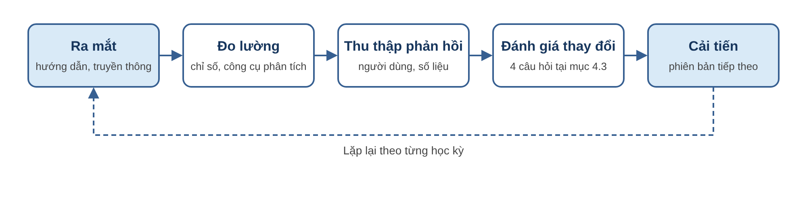

# KẾ HOẠCH QUẢN LÝ SẢN PHẨM

**PRODUCT MANAGEMENT PLAN | DỰ ÁN UNISUPPORT – STUDENT SUPPORT MANAGEMENT SYSTEM**

Đơn vị thực hiện: Nhóm 3

## Mục đích và phạm vi

Kế hoạch này quy định cách quản lý UniSupport với tư cách một sản phẩm, gồm: giá trị sản phẩm mang lại cho người dùng, nguyên tắc ra quyết định về sản phẩm, chỉ số đánh giá sản phẩm, quy trình ra mắt, đo lường và cải tiến, và định hướng phát triển sau khi bàn giao.

Tiến độ, chi phí, phân công và báo cáo dự án được quy định tại Master Schedule, Team Charter và Kế hoạch quản trị và giám sát; chất lượng kỹ thuật được quy định tại Kế hoạch quản lý chất lượng.

## 1. Sản phẩm và người dùng

**Tầm nhìn sản phẩm:** UniSupport là đầu mối duy nhất để sinh viên Aurora University gửi và theo dõi yêu cầu hỗ trợ, giúp nhà trường phản hồi nhanh, minh bạch và cải tiến dịch vụ dựa trên số liệu. Sản phẩm thay thế cách tiếp nhận rời rạc qua email, biểu mẫu trực tuyến, tin nhắn mạng xã hội và hồ sơ giấy.

| Người dùng | Vấn đề hiện tại | Giá trị UniSupport mang lại |
|---|---|---|
| Sinh viên (khoảng 3.000 người) | Không biết yêu cầu đang ở bước nào, ai xử lý; phải hỏi lại nhiều lần hoặc đến trực tiếp văn phòng. | Một nơi gửi yêu cầu, có mã Ticket, xem được tiến độ và kết quả, được thông báo khi có thay đổi. |
| Nhân viên các phòng ban | Yêu cầu nằm rải rác nhiều kênh, dễ bỏ sót hoặc nhiều người cùng xử lý một yêu cầu. | Hàng chờ rõ ràng theo phòng ban, mỗi Ticket có một người phụ trách, có cảnh báo sắp quá hạn. |
| Quản lý, Ban giám hiệu | Không có số liệu về khối lượng, thời gian xử lý và mức độ hài lòng để điều phối. | Dashboard và báo cáo theo phòng ban, nhóm vấn đề, thời gian xử lý và mức độ hài lòng. |

**Khách hàng và người dùng cuối:** Aurora University là khách hàng, chi trả và quyết định hướng phát triển của sản phẩm. Người dùng cuối là sinh viên và nhân viên các phòng ban. Các quyết định về sản phẩm được đánh giá dựa trên trải nghiệm và kết quả của người dùng cuối, cùng với yêu cầu của khách hàng.

## 2. Nguyên tắc quản lý sản phẩm

1. **Giải quyết vấn đề thực tế:** mỗi tính năng phải gắn với một vấn đề của người dùng tại mục 1.
2. **Chứng minh giá trị:** mỗi thay đổi phải xác định rõ nhóm người dùng được hưởng lợi và chỉ số tại mục 3 được cải thiện trước khi được chấp nhận.
3. **An toàn người dùng:** không chấp nhận tính năng làm lộ dữ liệu cá nhân hoặc làm sai phân quyền.
4. **Sẵn sàng sử dụng:** một phiên bản chỉ được phát hành khi đã có hướng dẫn sử dụng cho từng vai trò.
5. **Quyết định dựa trên dữ liệu:** quyết định về sản phẩm dựa trên các chỉ số tại mục 3 và phản hồi của người dùng.

## 3. Chỉ số đánh giá sản phẩm

Sản phẩm được đánh giá qua kết quả người dùng nhận được. Các chỉ số dưới đây được lấy chủ yếu từ Dashboard và báo cáo của UniSupport, giúp nhà trường tự theo dõi sau khi bàn giao.

| Chỉ số | Ý nghĩa | Nguồn số liệu | Mục tiêu năm đầu |
|---|---|---|---|
| Mức độ hài lòng của sinh viên (CSAT) | Điểm trung bình 1–5 sinh viên đánh giá sau khi Ticket được đóng; là chỉ số chính của sản phẩm. | Báo cáo CSAT | Từ 4,0/5 trở lên |
| Tỷ lệ sinh viên gửi đánh giá | Mức độ đại diện của điểm CSAT. | Báo cáo CSAT | Từ 30% Ticket đã đóng trở lên |
| Mức độ sử dụng | Tỷ lệ yêu cầu hỗ trợ trực tuyến được gửi qua UniSupport thay vì email, biểu mẫu hay tin nhắn. | Số Ticket so với thống kê kênh cũ của các phòng ban | Hướng tới 100% (mục tiêu G-01 trong PRD) |
| Tỷ lệ Ticket xử lý đúng hạn | Tỷ lệ Ticket được xử lý trong thời hạn mục tiêu của mức ưu tiên tương ứng. | Dashboard | Từ 90% trở lên |
| Thời gian xử lý trung bình | Thời gian từ khi tạo Ticket đến khi có kết quả, không tính thời gian chờ sinh viên bổ sung. | Báo cáo thời gian xử lý | Giảm qua từng học kỳ |
| Tỷ lệ Ticket bị mở lại | Mức độ giải quyết dứt điểm vấn đề ngay ở lần xử lý đầu tiên. | Lịch sử xử lý Ticket | Không quá 10% |
| Số lần sinh viên phải liên hệ hỏi tiến độ | Khả năng sinh viên tự theo dõi tiến độ trên hệ thống. | Bộ 5 câu hỏi tiến độ trong PRD | Giảm ít nhất 30% so với cách làm trước đây (theo PRD) |
| Nhóm vấn đề được hỏi nhiều nhất | Căn cứ bổ sung nội dung hướng dẫn và cải tiến quy trình của nhà trường. | Báo cáo xu hướng nhóm vấn đề | Dùng để cập nhật hướng dẫn và FAQ |

Mục tiêu về mức độ sử dụng và số lần hỏi tiến độ theo PRD. Các mục tiêu còn lại là mục tiêu đề xuất, được Aurora University xác nhận khi bàn giao và rà soát sau học kỳ đầu tiên dựa trên số liệu thực tế.

**Phân tích nguyên nhân:** khi một chỉ số không đạt mục tiêu, BA xác định nguyên nhân thuộc quy trình nghiệp vụ của nhà trường hay thuộc sản phẩm, chẳng hạn thông báo không đến người xử lý, phải qua nhiều bước mới tìm được Ticket, hoặc thiếu dấu hiệu nhận biết Ticket cần ưu tiên. Nguyên nhân thuộc sản phẩm được đưa vào danh sách cải tiến; nguyên nhân thuộc quy trình được báo cáo cho Aurora University.

## 4. Quy trình quản lý sản phẩm

Sản phẩm được quản lý theo một vòng lặp liên tục: ra mắt đến người dùng, đo lường, thu thập phản hồi, đánh giá thay đổi và cải tiến cho phiên bản tiếp theo.

*Hình 1. Vòng quản lý sản phẩm UniSupport*

### 4.1. Ra mắt sản phẩm đến người dùng

Khi bàn giao, sản phẩm được ra mắt theo các bước sau:

1. **Chuẩn bị nội dung ban đầu:** nạp sẵn danh sách nhóm vấn đề, phòng ban, ngày nghỉ và nội dung FAQ để sinh viên dùng được ngay từ ngày đầu.
2. **Tài liệu hướng dẫn:** hướng dẫn sử dụng cho từng vai trò Sinh viên, Nhân viên và Quản lý; một trang hướng dẫn nhanh; video demo ngắn các thao tác chính như gửi yêu cầu, theo dõi Ticket và đánh giá.
3. **Hướng dẫn cho người vận hành:** buổi hướng dẫn trực tiếp cho nhân viên và quản lý các phòng ban trước khi sử dụng chính thức.
4. **Truyền thông đến sinh viên:** phối hợp với nhà trường giới thiệu kênh hỗ trợ mới vào đầu học kỳ qua email sinh viên, trang thông tin và các kênh chính thức của trường, kèm hướng dẫn nhanh và video demo.

### 4.2. Đo lường và thu thập phản hồi

Các chỉ số tại mục 3 được theo dõi hằng tháng. Phản hồi được thu thập từ ba nguồn:

- **Sinh viên:** điểm và nhận xét CSAT, các Ticket bị mở lại cùng lý do.
- **Nhân viên và quản lý:** góp ý định kỳ về những thao tác còn bất tiện hoặc thông tin còn thiếu.
- **Số liệu sử dụng:** nhóm vấn đề phát sinh nhiều, phòng ban có nhiều Ticket quá hạn.

**Công cụ phân tích hành vi (đề xuất):** Google Analytics theo dõi lượt truy cập, thiết bị và các trang được sử dụng nhiều; Microsoft Clarity hoặc Hotjar ghi nhận bản đồ nhiệt và phiên thao tác để xác định các bước người dùng gặp khó hoặc bỏ dở. Công cụ chỉ được tích hợp khi Aurora University chấp thuận và phải che toàn bộ dữ liệu cá nhân theo nguyên tắc an toàn người dùng tại mục 2.

Kết quả đo lường và phản hồi được tổng hợp thành danh sách cải tiến sản phẩm (product backlog). Trong 30 ngày bảo hành, nhóm dự án tổng hợp và bàn giao danh sách này cho Aurora University; sau đó nhà trường tiếp tục theo dõi bằng Dashboard, báo cáo của hệ thống và các công cụ phân tích.

### 4.3. Đánh giá một thay đổi hoặc tính năng mới

Mọi đề xuất thay đổi, dù đến từ người dùng, nhà trường hay nhóm dự án, đều được đánh giá theo cùng bốn câu hỏi trước khi đưa vào danh sách cải tiến:

| Câu hỏi | Nội dung cần trả lời |
|---|---|
| Giải quyết vấn đề gì? | Vấn đề của nhóm người dùng nào tại mục 1; số liệu hoặc phản hồi chứng minh vấn đề. |
| Cải thiện chỉ số nào? | Chỉ số tại mục 3 được cải thiện và mức cải thiện dự kiến. |
| Có ảnh hưởng xấu không? | Ảnh hưởng đến an toàn dữ liệu, phân quyền và các chức năng đang vận hành. |
| Tốn bao nhiêu công sức? | Ước lượng công sức và thời gian; thay đổi trong thời gian dự án được xử lý theo quy trình kiểm soát thay đổi của Kế hoạch quản trị và giám sát. |

Business Analyst là đầu mối đánh giá và sắp xếp ưu tiên danh sách cải tiến; Aurora University quyết định thay đổi được thực hiện và phiên bản phát hành.

## 5. Định hướng phát triển sản phẩm

Phiên bản 1.0 được bàn giao theo phạm vi PRD. Lộ trình dưới đây định hướng các phiên bản tiếp theo, dựa trên các hạng mục ngoài phạm vi trong PRD và nhu cầu dự kiến khi vận hành. Lộ trình không phải cam kết; mỗi hướng được đánh giá theo mục 4.3 và được Aurora University chấp thuận trước khi thực hiện.

| Giai đoạn | Hướng phát triển | Làm gì | Vì sao | Điều kiện để làm |
|---|---|---|---|---|
| Ngắn hạn: học kỳ đầu sau bàn giao | Quản lý FAQ trên giao diện | Cho phép quản lý thêm, sửa nội dung FAQ ngay trên hệ thống. | Nhóm vấn đề phổ biến thay đổi theo thời điểm trong năm học; phiên bản 1.0 chỉ nạp sẵn FAQ khi triển khai. | Báo cáo xu hướng cho thấy FAQ cần cập nhật thường xuyên. |
|  | Thông báo qua email | Gửi email cho sinh viên và nhân viên khi Ticket có thay đổi quan trọng. | Phiên bản 1.0 chỉ có thông báo trong hệ thống; người dùng chưa đăng nhập không nhận được. | Số lần sinh viên hỏi tiến độ chưa giảm như mục tiêu, hoặc Ticket mới chậm được tiếp nhận. |
| Trung hạn: một đến hai năm | Ứng dụng di động | Ứng dụng riêng cho iOS và Android (hiện nằm ngoài phạm vi, NG-01). | Sinh viên chủ yếu dùng điện thoại; phiên bản 1.0 là ứng dụng web tương thích điện thoại. | Số liệu cho thấy phần lớn truy cập đến từ điện thoại và nhà trường có ngân sách. |
|  | Kết nối với hệ thống của trường | Đăng nhập một lần và lấy thông tin sinh viên từ hệ thống đào tạo (hiện nằm ngoài phạm vi, NG-02). | Giảm thao tác tạo tài khoản và nhập lại thông tin. | Nhà trường cung cấp giao diện kết nối và đồng ý về bảo mật dữ liệu. |
| Dài hạn: sau hai năm | Mở rộng phạm vi sử dụng | Áp dụng cho các dịch vụ hỗ trợ khác trong trường, như hỗ trợ giảng viên và cán bộ; về lâu dài đóng gói thành giải pháp cho các trường đại học khác. | Quy trình tiếp nhận và xử lý yêu cầu hỗ trợ tương đồng giữa các đơn vị và các trường, cho phép tái sử dụng sản phẩm. | Sản phẩm vận hành ổn định và đạt mục tiêu chỉ số ít nhất một năm học; có thỏa thuận với Aurora University về quyền sở hữu sản phẩm. |
