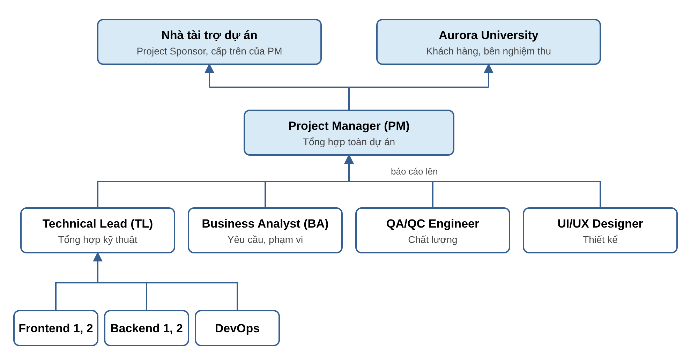

# KẾ HOẠCH QUẢN TRỊ VÀ GIÁM SÁT DỰ ÁN

**PROJECT GOVERNANCE & MONITORING PLAN | DỰ ÁN UNISUPPORT – STUDENT SUPPORT MANAGEMENT SYSTEM**

Đơn vị thực hiện: Nhóm 3

## Mục đích và phạm vi

Kế hoạch này quy định cách báo cáo tình hình dự án từ người thực hiện lên quản lý dự án, rồi lên Nhà tài trợ dự án (Project Sponsor) và khách hàng Aurora University. Kế hoạch trả lời bốn câu hỏi: ai báo cáo cho ai, báo cáo khi nào, báo cáo những gì, và khi có vấn đề thì xử lý ra sao. Mục tiêu là để người quản lý luôn biết dự án đang đi đúng hay lệch kế hoạch, từ đó quyết định kịp thời.

Kế hoạch dựa trên cơ cấu vai trò và quy tắc làm việc trong Team Charter, lịch thực hiện trong Master Schedule, kế hoạch giờ công và chi phí trong ngân sách nội bộ và các cam kết với khách hàng trong Proposal.

## 1. Cơ cấu quản trị và tuyến báo cáo

Dự án có bốn cấp báo cáo. Thành viên thực hiện báo cáo cho người phụ trách lĩnh vực của mình; người phụ trách các lĩnh vực báo cáo cho Project Manager (PM); PM tổng hợp và báo cáo lên hai phía. Phía thứ nhất là Nhà tài trợ dự án (Project Sponsor), tức cấp trên trực tiếp của PM trong đơn vị thực hiện: người cung cấp nguồn lực, chịu chi phí và phê duyệt những quyết định vượt thẩm quyền của PM. Phía thứ hai là Aurora University, khách hàng của dự án.

*Hình 1. Tuyến báo cáo của dự án UniSupport*

### 1.1. Trách nhiệm báo cáo theo từng cấp

| Cấp | Vai trò | Báo cáo cho | Chịu trách nhiệm báo cáo về |
|---|---|---|---|
| Cấp 1 – Thực hiện | Frontend Developer 1, 2; Backend Developer 1, 2; DevOps Engineer | Technical Lead | Tiến độ từng công việc được giao, số giờ đã làm, vướng mắc kỹ thuật, tình trạng môi trường (DevOps). |
| Cấp 2 – Phụ trách lĩnh vực | Technical Lead (TL) | PM | Tiến độ phát triển chung, mã nguồn đang chờ review, vấn đề và rủi ro kỹ thuật. |
|  | Business Analyst (BA) | PM | Câu hỏi về yêu cầu chưa được giải đáp, yêu cầu thay đổi, các cập nhật PRD. |
|  | QA/QC Engineer | PM | Kết quả kiểm thử, số lỗi đang mở, kết quả đánh giá chất lượng của mốc. |
|  | UI/UX Designer | PM | Tiến độ thiết kế và các phản hồi về giao diện. |
| Cấp 3 – Quản lý dự án | Project Manager (PM) | Nhà tài trợ dự án | Tiến độ, chi phí so với ngân sách, rủi ro lớn và các đề xuất cần Nhà tài trợ dự án quyết định như bổ sung nhân sự hay điều chỉnh ngân sách. |
|  |  | Aurora University | Kết quả từng mốc, rủi ro ảnh hưởng đến khách hàng và các nội dung cần khách hàng xác nhận. |
| Cấp 4 – Nhà tài trợ, khách hàng | Nhà tài trợ dự án; Aurora University | — | Nhận báo cáo, đưa ra quyết định thuộc thẩm quyền và phản hồi cho PM. |

QA/QC báo cáo trực tiếp cho PM, không qua TL, để kết quả kiểm thử được đánh giá độc lập với nhóm phát triển. Khi PM vắng mặt, BA tạm thời nhận báo cáo và điều phối dự án. Nhiệm vụ chi tiết của từng vai trò được quy định trong Team Charter.

**Dữ liệu gốc luôn mở cho cấp trên.** Báo cáo được tổng hợp theo từng cấp, nhưng số liệu không bị lọc qua từng cấp. Mọi số liệu trong báo cáo đều dẫn về dữ liệu gốc: trạng thái issue và lỗi trên GitHub, bảng theo dõi giờ, sổ rủi ro và nhật ký vấn đề trên Google Drive. PM và Nhà tài trợ dự án có quyền xem trực tiếp các dữ liệu này bất cứ lúc nào để tự kiểm tra, không phải chờ đến kỳ báo cáo.

### 1.2. Luồng thông tin từ trên xuống

Báo cáo đi lên để cấp trên nắm tình hình; theo chiều ngược lại, thông tin từ cấp trên được truyền xuống như sau:

1. **Tiếp nhận:** PM là đầu mối duy nhất nhận câu hỏi, yêu cầu và quyết định từ Nhà tài trợ dự án và Aurora University, để các thành viên không nhận những chỉ đạo khác nhau.
2. **Truyền đạt:** PM ghi quyết định vào Decision Log và thông báo cho người phụ trách lĩnh vực liên quan, nội dung khẩn qua Discord, nội dung thông thường tại buổi họp tuần. Với câu hỏi cần số liệu, PM yêu cầu người phụ trách cung cấp kèm thời hạn, rồi tổng hợp và trả lời cấp trên.
3. **Thực hiện và báo lại:** người phụ trách chuyển quyết định thành issue và phân công; người được giao xác nhận trong thời gian phản hồi của Team Charter. PM báo lại kết quả cho cấp trên trong kỳ báo cáo tiếp theo, khép kín vòng thông tin: báo cáo đi lên, quyết định đi xuống, kết quả được báo lại.

## 2. Quy trình báo cáo

Dự án sử dụng sáu loại báo cáo, từ cập nhật chi tiết hằng ngày đến báo cáo tổng hợp theo mốc. Bảng dưới đây tóm tắt; nội dung của từng loại được trình bày ở các mục tiếp theo.

| Loại báo cáo | Thời điểm | Người lập → người nhận | Hình thức |
|---|---|---|---|
| Họp nhanh và cập nhật hằng ngày | Họp nhanh 15 phút lúc 20h00; cập nhật công việc trước 22h00 | Từng thành viên → người phụ trách lĩnh vực và PM | Họp trực tuyến trên Discord; cập nhật trạng thái issue trên GitHub |
| Báo cáo tuần | Trước buổi họp nhóm tối Chủ Nhật | Người phụ trách lĩnh vực → PM; PM tổng hợp thành báo cáo tình hình dự án | Báo cáo viết, trình bày tại buổi họp |
| Báo cáo tháng | Cuối mỗi tháng | PM → Nhà tài trợ dự án | Báo cáo viết ngắn gọn |
| Báo cáo mốc | Khi kết thúc mỗi mốc trong Master Schedule | PM → Aurora University và Nhà tài trợ dự án | Báo cáo viết, kèm biên bản đánh giá chất lượng của mốc |
| Báo cáo cảnh báo | Ngay khi phát hiện vấn đề | Người phát hiện → người phụ trách trực tiếp → PM | Tin nhắn Discord gắn tên người nhận, sau đó ghi vào nhật ký vấn đề |
| Báo cáo tổng kết | Khi bàn giao | PM → Nhà tài trợ dự án; phần kết quả sản phẩm gửi Aurora University | Báo cáo viết; phần kết quả sản phẩm nằm trong hồ sơ bàn giao |

### 2.1. Họp nhanh và cập nhật hằng ngày

Vào 20h00 mỗi ngày làm việc, tức đầu khung giờ làm việc chung theo Team Charter, nhóm họp nhanh (daily stand-up) trên Discord trong tối đa 15 phút. PM chủ trì; mỗi thành viên lần lượt trả lời ngắn gọn ba câu hỏi:

1. Từ lần họp trước đến nay mình đã làm xong những gì?
2. Hôm nay mình sẽ làm gì?
3. Mình đang gặp khó khăn hay vướng mắc gì cần người khác hỗ trợ?

Buổi họp nhanh chỉ để nắm tình hình, không giải quyết vấn đề tại chỗ. Vướng mắc được PM ghi lại; người phụ trách lĩnh vực trao đổi riêng với người liên quan ngay sau buổi họp. Thành viên vắng mặt gửi câu trả lời cho ba câu hỏi bằng tin nhắn trong kênh chung trước buổi họp. Vấn đề nghiêm trọng được báo cáo theo hình thức cảnh báo tại mục 2.5.

Trước 22h00, mỗi thành viên cập nhật trạng thái issue trên GitHub (cần làm, đang làm, đang review, chờ xác minh, hoàn thành), đồng thời ghi số giờ đã làm cho từng công việc vào bảng theo dõi giờ trên Google Drive. Số giờ này là nguồn dữ liệu để PM tính chi phí thực tế và so sánh với kế hoạch.

### 2.2. Báo cáo tuần

Trước buổi họp nhóm tối Chủ Nhật, mỗi người phụ trách lĩnh vực gửi phần báo cáo của mình theo nội dung đã nêu ở mục 1.1; riêng QA/QC báo cáo các chỉ số chất lượng theo Kế hoạch quản lý chất lượng. Theo Team Charter, PM gửi chương trình họp trước buổi họp 4 giờ.

PM tổng hợp các phần trên thành Báo cáo tình hình dự án tuần theo mẫu tại mục 6.2. Tại buổi họp, nhóm cũng rà soát sổ rủi ro theo mục 3.2. Kết luận và các việc cần làm sau buổi họp được ghi vào biên bản họp, có người phụ trách và thời hạn.

### 2.3. Báo cáo tháng cho Nhà tài trợ dự án

Cuối mỗi tháng, PM gửi Nhà tài trợ dự án một báo cáo ngắn gọn, đủ để Nhà tài trợ dự án nắm tình hình mà không cần đọc chi tiết từng công việc. Báo cáo gồm:

- **Tiến độ:** dự án đang ở mốc nào, các mốc đã hoàn thành, dự báo thời điểm bàn giao so với Master Schedule.
- **Chi phí:** số giờ công và chi phí nhân sự thực tế đến thời điểm báo cáo, so với ngân sách nhân sự kế hoạch. Chi phí thực tế được tính bằng số giờ thực tế của từng vai trò nhân với đơn giá giờ trong kế hoạch ngân sách nội bộ.
- **Chất lượng:** kết luận đánh giá chất lượng của các mốc đã qua và số lỗi nghiêm trọng còn mở.
- **Rủi ro và khó khăn lớn:** những vấn đề có thể ảnh hưởng đến tiến độ, chi phí hoặc quan hệ với khách hàng.
- **Đề xuất cần quyết định:** ví dụ bổ sung hoặc điều chuyển nhân sự, sử dụng chi phí dự phòng, điều chỉnh phạm vi hoặc thời hạn với khách hàng.
- **Tình hình với khách hàng:** các nội dung đã được Aurora University xác nhận, các phản hồi đang chờ, và các khoản thanh toán theo hợp đồng.

### 2.4. Báo cáo mốc

Khi kết thúc mỗi mốc trong Master Schedule, PM gửi Aurora University báo cáo mốc, đồng thời gửi bản sao cho Nhà tài trợ dự án. Nội dung gồm:

- Kết quả đạt được so với nội dung công việc của mốc.
- Kết luận đánh giá chất lượng của mốc, theo Kế hoạch quản lý chất lượng.
- Tiến độ tổng thể và dự báo thời điểm bàn giao.
- Số giờ công đã sử dụng so với kế hoạch.
- Rủi ro và vấn đề có thể ảnh hưởng đến khách hàng.
- Những nội dung cần Aurora University xác nhận hoặc cung cấp, ví dụ thông tin nghiệp vụ, điều kiện hạ tầng hoặc ý kiến phản hồi.
- Kế hoạch của mốc tiếp theo.

### 2.5. Báo cáo cảnh báo

Một số tình huống phải được báo cáo ngay, không chờ đến kỳ báo cáo tuần:

- Có nguy cơ trễ hạn công việc. Theo Team Charter, thành viên báo PM ngay khi phát hiện, ưu tiên trước hạn 24–48 giờ.
- Phát hiện lỗi nghiêm trọng, tức lỗi làm gián đoạn chức năng chính.
- Có vấn đề khiến công việc của người khác không thể tiếp tục.
- Xuất hiện rủi ro mới hoặc yêu cầu thay đổi phạm vi.
- Thông tin, phản hồi hoặc hạ tầng từ phía Aurora University bị chậm so với kế hoạch.

Báo cáo cảnh báo cần nêu rõ bốn điều: vấn đề là gì, ảnh hưởng đến công việc và mốc nào, đề xuất cách xử lý, và cần ai quyết định. Báo cáo được gửi qua kênh khẩn cấp trên Discord; theo Team Charter, người nhận phải phản hồi trong 1–2 giờ. Nếu vấn đề có thể làm chậm tiến độ hoặc tăng chi phí, PM báo ngay cho Nhà tài trợ dự án. Nếu vấn đề ảnh hưởng đến cam kết với khách hàng, PM chủ động thông báo cho Aurora University, đúng như Proposal đã cam kết.

### 2.6. Báo cáo tổng kết

Khi bàn giao, PM lập báo cáo tổng kết dự án gồm: kết quả so với kế hoạch về phạm vi, tiến độ, giờ công và chi phí; kết quả kiểm thử và nghiệm thu nội bộ; các vấn đề còn tồn đọng; và bài học kinh nghiệm của nhóm. Báo cáo được gửi Nhà tài trợ dự án; phần kết quả sản phẩm nằm trong hồ sơ bàn giao cho Aurora University.

## 3. Chỉ số giám sát và ngưỡng cảnh báo

### 3.1. Ngưỡng cảnh báo

Mỗi báo cáo tuần, báo cáo tháng và báo cáo mốc đánh giá bốn lĩnh vực theo ba mức: Xanh là đúng kế hoạch, Vàng là có sai lệch nhưng còn kiểm soát được, Đỏ là cần PM xử lý ngay. Trạng thái chung của dự án lấy theo lĩnh vực có mức xấu nhất.

| Lĩnh vực | Chỉ số và cách đo | Xanh | Vàng | Đỏ |
|---|---|---|---|---|
| Tiến độ | Tỷ lệ công việc hoàn thành đúng ngày dự kiến ghi trong issue; dự báo ngày kết thúc mốc so với Master Schedule. | Tỷ lệ đúng hạn đạt mức kỳ vọng trong Team Charter và mốc dự kiến kết thúc đúng ngày. | Tỷ lệ đúng hạn thấp hơn mức kỳ vọng, nhưng mốc vẫn dự kiến kết thúc đúng ngày. | Mốc dự kiến kết thúc trễ so với Master Schedule. |
| Giờ công và chi phí | Dự báo tổng giờ = giờ thực tế đã sử dụng + giờ kế hoạch của phần việc còn lại; chi phí tính theo đơn giá giờ của từng vai trò. So sánh với ngân sách trong kế hoạch ngân sách nội bộ. | Dự báo không vượt ngân sách cơ sở. | Dự báo vượt ngân sách cơ sở nhưng không vượt tổng ngân sách, tức đang dùng đến phần dự phòng. | Dự báo vượt tổng ngân sách gồm cả dự phòng. |
| Chất lượng | Số lỗi nghiêm trọng đang mở; các chỉ số và kết luận đánh giá chất lượng theo Kế hoạch quản lý chất lượng. | Không có lỗi nghiêm trọng đang mở; các chỉ số chất lượng đạt ngưỡng. | Có lỗi nghiêm trọng đang được sửa hoặc có chỉ số chưa đạt ngưỡng, chưa đến cuối mốc. | Còn lỗi nghiêm trọng khi kết thúc mốc, hoặc mốc không đạt đánh giá chất lượng. |
| Phạm vi | Số yêu cầu thay đổi đang chờ xử lý. | Không có yêu cầu thay đổi. | Có yêu cầu thay đổi đang đánh giá. | Có thay đổi ảnh hưởng đến ngày bàn giao hoặc chi phí, cần Aurora University xác nhận. |

Mức kỳ vọng về tỷ lệ đúng hạn lấy theo Team Charter; ngân sách cơ sở, phần dự phòng và tổng ngân sách lấy theo kế hoạch ngân sách nội bộ hiện hành. Khi các tài liệu này được điều chỉnh, ngưỡng cảnh báo áp dụng theo giá trị mới.

**Hành động theo từng mức:**

- **Xanh:** tiếp tục thực hiện theo kế hoạch.
- **Vàng:** người phụ trách lĩnh vực đề xuất hướng khắc phục; PM theo dõi kết quả trong báo cáo tuần tiếp theo.
- **Đỏ:** PM xử lý ngay bằng cách điều chỉnh phân công, thứ tự công việc hoặc sử dụng giờ dự phòng. PM báo cáo Nhà tài trợ dự án khi cần bổ sung nguồn lực hoặc chi phí. Nếu ảnh hưởng đến mốc, phạm vi hoặc chi phí đã cam kết với khách hàng, PM thông báo Aurora University và xử lý theo quy trình kiểm soát thay đổi tại mục 5.

### 3.2. Giám sát rủi ro

Ngoài các vấn đề đã xảy ra, PM theo dõi những rủi ro có thể xảy ra trong sổ rủi ro. Mỗi rủi ro ghi: mô tả, khả năng xảy ra (thấp, trung bình, cao), mức ảnh hưởng (thấp, trung bình, cao), người theo dõi, biện pháp phòng ngừa và dấu hiệu cho thấy rủi ro sắp xảy ra.

Sổ rủi ro ban đầu được lập từ cột rủi ro chính trong kế hoạch ngân sách nội bộ, ví dụ: sai phân quyền và kiểm soát truy cập; quy tắc mức ưu tiên và thời hạn xử lý; đồng bộ trạng thái và lịch sử Ticket giữa sinh viên và nhân viên. Tại buổi họp tuần, nhóm bổ sung rủi ro mới, cập nhật mức độ và đóng các rủi ro không còn khả năng xảy ra. Rủi ro đã xảy ra được chuyển sang nhật ký vấn đề và xử lý theo mục 4. Báo cáo tháng nêu các rủi ro đang ở mức cao.

### 3.3. Chỉ số giá trị đạt được (EVM)

Cuối mỗi mốc, PM tính hai chỉ số theo phương pháp giá trị đạt được (Earned Value Management – EVM) để đánh giá cùng lúc tiến độ và chi phí, đơn vị là giờ công. Giá trị kế hoạch (PV) là số giờ kế hoạch của phần việc lẽ ra phải xong; giá trị đạt được (EV) là số giờ kế hoạch của phần việc thực tế đã xong đúng DoD; chi phí thực tế (AC) là số giờ đã sử dụng.

| Chỉ số | Công thức | Ý nghĩa |
|---|---|---|
| SPI | EV ÷ PV | Từ 1 trở lên: đúng hoặc nhanh hơn kế hoạch. Dưới 1: chậm so với kế hoạch. |
| CPI | EV ÷ AC | Từ 1 trở lên: không vượt số giờ kế hoạch. Dưới 1: tốn nhiều giờ hơn kế hoạch. |

Khi SPI hoặc CPI dưới 1, PM nêu nguyên nhân và hướng khắc phục trong báo cáo mốc.

## 4. Chuyển cấp vấn đề và quyền quyết định

Khi gặp vấn đề, thành viên liên hệ người phụ trách trực tiếp của lĩnh vực trước. Vấn đề chỉ được chuyển lên cấp tiếp theo khi người phụ trách trực tiếp không xử lý được, hoặc khi vấn đề ảnh hưởng đến tiến độ, phạm vi hay chất lượng. Tuyến chuyển cấp chi tiết theo từng loại vấn đề và các quyết định trong nội bộ nhóm được quy định trong Team Charter. Bảng dưới đây nêu các cấp quyết định của dự án:

| Loại quyết định | Người quyết định |
|---|---|
| Vấn đề trong nội bộ nhóm: cách triển khai, kỹ thuật, phân công, thời hạn | Theo Team Charter; PM quyết định khi bế tắc hoặc khẩn cấp |
| Sử dụng giờ dự phòng trong phạm vi tổng ngân sách | PM |
| Bổ sung nhân sự, vượt ngân sách nhân sự kế hoạch | Nhà tài trợ dự án, theo đề xuất của PM |
| Thay đổi phạm vi, chi phí hoặc tiến độ đã thống nhất với khách hàng | Aurora University xác nhận bằng văn bản |

Mọi quyết định quan trọng được ghi vào Decision Log để các thành viên tra cứu khi cần.

## 5. Kiểm soát thay đổi

Mọi thay đổi về phạm vi, chi phí hoặc tiến độ phải được đánh giá và xác nhận trước khi thực hiện, theo cam kết trong Proposal và ràng buộc dự án trong PRD. Quy trình gồm năm bước:

1. **Ghi nhận.** Người đề xuất, có thể là thành viên nhóm hoặc Aurora University, gửi yêu cầu thay đổi cho BA, nêu rõ nội dung và lý do.
2. **Đánh giá ảnh hưởng.** BA phối hợp với TL đánh giá ảnh hưởng của thay đổi đến phạm vi, số giờ công, tiến độ và các tài liệu liên quan.
3. **Quyết định.** PM quyết định trong nội bộ. Nếu thay đổi ảnh hưởng đến phạm vi, chi phí hoặc tiến độ đã thống nhất với khách hàng, PM gửi Aurora University xác nhận bằng văn bản trước khi thực hiện.
4. **Cập nhật kế hoạch.** Khi thay đổi được chấp thuận, BA cập nhật PRD, PM cập nhật Master Schedule và các issue trên GitHub. Quyết định được ghi vào Decision Log.
5. **Theo dõi.** Thay đổi được theo dõi trong báo cáo tuần cho đến khi hoàn thành.

Yêu cầu tính năng mới phát sinh trong thời gian bảo hành không thuộc phạm vi bảo hành và cũng được xử lý theo quy trình này.

## 6. Nhật ký quản trị và mẫu báo cáo

### 6.1. Nhật ký quản trị

| Nhật ký | Nội dung | Người cập nhật | Nơi lưu |
|---|---|---|---|
| Bảng theo dõi giờ | Ngày, người thực hiện, công việc, số giờ. | Từng thành viên; PM tổng hợp | Google Drive |
| Nhật ký vấn đề | Mô tả vấn đề, ngày phát hiện, ảnh hưởng, người xử lý, thời hạn, trạng thái. | PM | Google Drive |
| Sổ rủi ro | Mô tả, khả năng xảy ra, mức ảnh hưởng, người theo dõi, biện pháp phòng ngừa, dấu hiệu cảnh báo. | PM; người theo dõi từng rủi ro | Google Drive |
| Decision Log | Ngày, nội dung quyết định, người quyết định, lý do, tài liệu cần cập nhật. | PM | Google Drive |
| Biên bản họp tuần | Nội dung thảo luận, việc cần làm, người phụ trách, thời hạn. | Thành viên ghi biên bản theo lượt | Google Drive |
| Báo cáo tuần, tháng và báo cáo mốc | Theo mục 2.2, 2.3, 2.4 và mẫu tại mục 6.2. | PM | Google Drive |

### 6.2. Mẫu và ví dụ báo cáo tuần

Báo cáo tình hình dự án tuần được lập theo mẫu dưới đây. Cột Ví dụ minh họa báo cáo tuần 02/11–08/11/2026 của Mốc 2, với số liệu giả định.

| Mục | Nội dung cần điền | Ví dụ |
|---|---|---|
| Kỳ báo cáo | Tuần báo cáo; mốc hiện tại trong Master Schedule; người lập. | Tuần 02/11–08/11/2026; Mốc 2 – Tiếp nhận Ticket; PM lập. |
| Trạng thái chung | Xanh, Vàng hoặc Đỏ, lấy theo lĩnh vực có mức xấu nhất ở mục 3.1. | Vàng, do tiến độ ở mức Vàng. |
| Tiến độ | Số công việc hoàn thành; tỷ lệ đúng hạn; công việc đang chậm; dự báo ngày kết thúc mốc. | Vàng: 5/7 công việc đúng hạn (71%, thấp hơn mức kỳ vọng 85% trong Team Charter); chức năng sinh mã Ticket chậm 2 ngày; Mốc 2 vẫn dự kiến kết thúc đúng ngày 12/11. |
| Giờ công và chi phí | Giờ thực tế trong tuần và lũy kế; chi phí tương ứng; dự báo so với ngân sách cơ sở và tổng ngân sách. | Xanh: tuần này 52 giờ, lũy kế 214 giờ (khoảng 64,6 triệu đồng); dự báo 612 giờ, chưa vượt ngân sách cơ sở 618 giờ. |
| Chất lượng | Số lỗi đang mở theo mức độ; công việc chờ xác minh; các chỉ số chất lượng. | Xanh: không có lỗi nghiêm trọng; 3 lỗi thông thường đang sửa; 4 công việc chờ xác minh. |
| Phạm vi | Yêu cầu thay đổi mới, đang đánh giá hoặc đã quyết định. | Xanh: không có yêu cầu thay đổi. |
| Rủi ro và vấn đề | Rủi ro ở mức cao; vấn đề mới hoặc chưa xử lý xong, người phụ trách, thời hạn. | Rủi ro sai phạm vi dữ liệu khi lọc hàng chờ (trung bình): đã bổ sung test case truy cập chéo. Chậm sinh mã Ticket: TL hỗ trợ BE1, hạn mới 10/11. |
| Cần quyết định | Nội dung cần PM, nhóm, Nhà tài trợ dự án hoặc Aurora University quyết định. | Không có. |
| Kế hoạch tuần tới | Các công việc chính và mục tiêu của tuần tiếp theo. | Hoàn thành theo dõi Ticket và thông báo; bắt đầu mức ưu tiên và thời hạn xử lý (Mốc 3); kiểm thử hồi quy Mốc 2 trước khi đánh giá chất lượng cuối mốc. |
